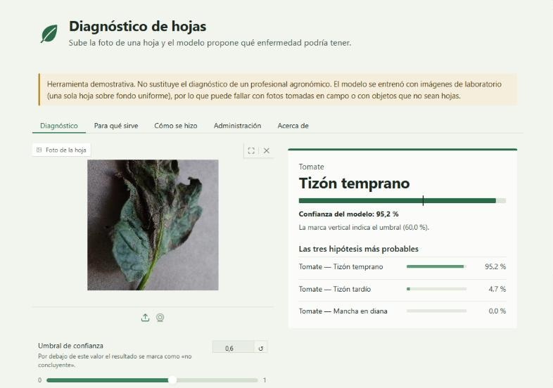

# Diagnóstico de hojas con inteligencia artificial

Aplicación web en español que mira la foto de una hoja y propone **qué enfermedad podría tener**. Reconoce 38 clases de 14 cultivos del conjunto [PlantVillage](https://arxiv.org/abs/1511.08060) y muestra las tres hipótesis más probables con la *confianza del modelo*.

**Página del proyecto** (qué es, cómo se hizo paso a paso, ejemplos con resultados reales): https://josegme.github.io/plantvillage-app/



> Herramienta demostrativa. No sustituye el diagnóstico de un profesional agronómico. Se entrenó con fotos de laboratorio y puede fallar con fotos del campo o con imágenes que no sean hojas.

## Qué incluye

- **Diagnóstico:** sube una foto o usa la cámara, y obtén las 3 hipótesis con su confianza. Si la mejor queda por debajo de un umbral que tú eliges (60 % por defecto), el resultado se marca como «no concluyente».
- **Para qué sirve y Cómo se hizo:** dos pestañas escritas para quien no conoce el tema, con el recorrido del entrenamiento y el porqué de cada paso.
- **Administración** (con contraseña): historial de consultas filtrable, descarga en CSV, métricas del modelo, matriz de confusión y versión del modelo.
- **Acerca de:** datos, atribución, métricas y limitaciones.

## Resultados del modelo

Medidos en 5.431 imágenes de prueba que el modelo no vio durante el entrenamiento. Las cifras se leen de [`modelo/metricas_test.json`](modelo/metricas_test.json).

| Medida | Resultado |
|---|---|
| Exactitud | 97,40 % |
| F1 macro | 96,68 % |
| Exactitud top-3 | 99,82 % |
| Hojas enfermas dadas por sanas | 8 de 3.923 |

Son resultados con fotos de laboratorio. Con fotos tomadas en el campo se espera un rendimiento menor.

## Ejecutarla en tu equipo

Necesitas **Python 3.13** y **[Git LFS](https://git-lfs.com)** (el modelo, de unos 10 MB, se guarda con esa extensión de Git).

```powershell
git clone https://github.com/Josegme/plantvillage-app.git
cd plantvillage-app
py -3.13 -m venv .venv
.venv\Scripts\python.exe -m pip install -r requirements.txt
```

Después, en Windows, haz doble clic en **`iniciar.bat`**: arranca la aplicación y abre el navegador cuando está lista. También puedes arrancarla a mano:

```powershell
.venv\Scripts\python.exe app.py
```

y abrir <http://127.0.0.1:7860>. En macOS o Linux usa `python3.13` y `.venv/bin/python`.

La pestaña de **Administración** solo se activa si defines antes la variable de entorno `ADMIN_PASSWORD` (`iniciar.bat` te pide la clave al arrancar):

```powershell
$env:ADMIN_PASSWORD = "elige-una-clave"
```

## Estructura del proyecto

| Archivo | Responsabilidad |
|---|---|
| `app.py` | Punto de entrada: interfaz Gradio con sus pestañas. |
| `inferencia.py` | Carga del modelo una sola vez (con una predicción de calentamiento) y predicción. |
| `preprocesado.py` | Validación de la imagen (formato, 5 MB, número de píxeles) y preprocesado idéntico al de la evaluación. |
| `etiquetas.py` | Traducción al español de las 38 clases. |
| `historial.py` | Historial en SQLite: solo metadatos y exportación a CSV. |
| `admin.py` | Contraseña, sesiones con token y bloqueo por intentos fallidos. |
| `metricas.py`, `contenido.py` | Lectura de las métricas y de los textos con sus cifras. |
| `presentacion.py`, `estilos.css` | Tema visual y el componente de resultado. |
| `contenido/` | Textos de las pestañas explicativas y de esta página. |
| `docs/` | Página del proyecto (GitHub Pages), generada con `scripts/generar_pagina.py`. |
| `modelo/` | Modelo entrenado, clases, métricas, matriz de confusión y fotos de ejemplo. |
| `tests/` | Pruebas automáticas. |
| `CONTRIBUTING.md`, `LICENSE` | Cómo proponer mejoras y licencia (MIT). |
| `scripts/` | Generadores de la página, el README y las imágenes para redes. |

## Pruebas

```powershell
pip install -r requirements-dev.txt
python -m pytest -q
```

Cubren, entre otras cosas, que el preprocesado reproduce las predicciones de la evaluación, que las 38 clases están traducidas, la lógica del umbral, el rechazo de imágenes inválidas, que la administración falla sin contraseña correcta (también por la vía de la API), que el CSV neutraliza fórmulas, el contraste de la interfaz y la coherencia de la página del proyecto.

## Privacidad y seguridad

- El historial guarda **solo metadatos** de cada consulta (fecha UTC, hipótesis principal, confianza, si fue no concluyente, latencia y una huella SHA-256 truncada). Nunca la imagen.
- La copia temporal de la imagen se elimina del servidor al terminar la consulta; si se sube y no se diagnostica, se borra en unos 6 minutos como máximo. Los nombres de archivo no se escriben en los registros.
- La administración falla cerrada (sin `ADMIN_PASSWORD` queda deshabilitada). Cada función de administración verifica en el servidor un token de sesión aleatorio, y los intentos fallidos se bloquean con espera creciente.

## Cómo se entrenó

Se usó transferencia de aprendizaje con **MobileNetV2** preentrenada en ImageNet, en dos fases (capa nueva y ajuste fino de las capas profundas), con aumento de datos y una parte de prueba usada una sola vez. El recorrido completo está en la pestaña «Cómo se hizo» de la aplicación y en la [página del proyecto](https://josegme.github.io/plantvillage-app/#como-se-hizo).

## Despliegue en Hugging Face Spaces

Un Space de tipo Gradio requiere un plan de pago, así que por ahora la aplicación se ejecuta en local. Cuando se despliegue, el `README.md` del Space debe empezar con el bloque descrito en [`despliegue/huggingface-spaces.md`](despliegue/huggingface-spaces.md).

## Contribuir

Este proyecto es un ejercicio de aprendizaje y **cualquier mejora es bienvenida**: probarlo con fotos del campo, añadir cultivos, traducir la interfaz, mejorar el modelo o corregir un texto. Mira [`CONTRIBUTING.md`](CONTRIBUTING.md) para saber cómo proponer un cambio, o abre un *issue* con tu idea.

## Licencia

El código se distribuye bajo la [licencia MIT](LICENSE). El conjunto de datos PlantVillage, con el que se entrenó el modelo, conserva sus propios términos de uso.

## Créditos

El modelo se entrenó con **PlantVillage** (Hughes y Salathé, 2015, *An open access repository of images on plant health to enable the development of mobile disease diagnostics*, [arXiv:1511.08060](https://arxiv.org/abs/1511.08060)). El mérito del conjunto de datos es de sus autores.
